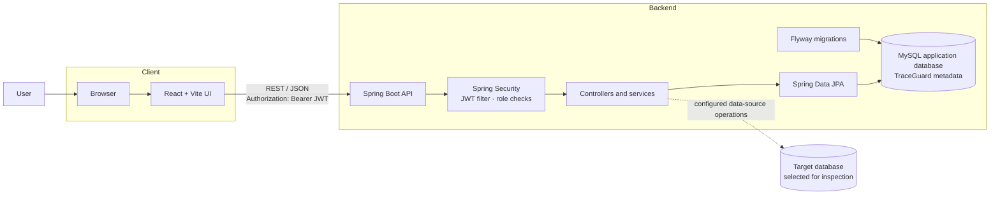

# TraceGuard

> **Database integrity analysis and monitoring** — connect a data source, understand its structure, and make integrity findings easier to investigate.

TraceGuard is a web application organized around database projects. Its interface includes project and connection management, schema exploration, integrity scanning and results, traceability, security analysis, scan history, and reports. The repository contains a React frontend, a Spring Boot backend for authentication and user management, and versioned MySQL schema migrations for TraceGuard's application data.

> **Repository status:** the frontend's `?dev=1` preview uses illustrative data and does not connect to Northwind or a target database. Do not treat preview screens or sample metrics as live scan results. See [Current implementation notes](#current-implementation-notes).

## Contents

- [Architecture](#architecture)
- [Features](#features)
- [Technology](#technology)
- [Repository layout](#repository-layout)
- [Prerequisites](#prerequisites)
- [Run the frontend preview](#run-the-frontend-preview)
- [Run the backend](#run-the-backend)
- [Connect frontend and backend](#connect-frontend-and-backend)
- [Configuration reference](#configuration-reference)
- [Authentication and roles](#authentication-and-roles)
- [Database migrations](#database-migrations)
- [Development commands](#development-commands)
- [Current implementation notes](#current-implementation-notes)
- [Security notes](#security-notes)

## Architecture



The browser communicates with the API; it does not connect directly to MySQL. The MySQL database configured in `application.yml` is the **TraceGuard application database**. A target database is a separate data source selected for inspection. Keep their credentials and access policies separate.

## Features

- Project-oriented workspace with dashboard and project access views.
- Database connection and schema exploration screens.
- Integrity scanner, results, finding details, and scan history screens.
- Traceability, security analysis, and report screens.
- Role-aware navigation for `ADMIN`, `DEVELOPER`, and `AUDITOR` roles.
- Backend JWT authentication and administrator-only user management.
- Flyway-managed application database schema, including access, rules, scanning, issues, fixes, evaluation, views, and seed data migrations.
- Local frontend preview mode for exploring the UI without a running backend.

The availability of a screen does not by itself guarantee that every operation is connected to a live scanner or target database. Review the implementation notes before using the project for real data.

## Technology

| Area | Technology |
| --- | --- |
| Frontend | React 19, Vite 6, React Router 7, Axios |
| Backend | Java 21, Spring Boot 3.5, Spring Web, Spring Security, Spring Data JPA |
| Application database | MySQL |
| Schema migrations | Flyway |
| Authentication | JWT, BCrypt password hashing |

## Repository layout

```text
.
├── frontend/                         # Main React + Vite application
├── backend-auth-phase1/
│   ├── backend/                       # Spring Boot API and Flyway migrations
│   └── frontend/                      # Earlier frontend copy
├── traceguard-ui-revised.html         # Standalone UI preview artifact
└── TraceGuard-Presentation.pptx       # Project presentation
```

Use the root `frontend/` directory for frontend development. The nested `backend-auth-phase1/frontend/` is a separate, earlier copy and is not needed to run the root frontend with the backend.

## Prerequisites

- Node.js and npm (use a current Node.js LTS release).
- Java 21.
- MySQL compatible with the configured MySQL JDBC driver.
- A shell that can run the Maven wrapper (`./mvnw`).

## Run the frontend preview

```bash
cd frontend
npm install
npm run dev
```

Open the Vite URL with `/login?dev=1`, typically:

```text
http://localhost:5173/login?dev=1
```

In this local preview, any password works and the role selector switches between sample role views. Preview data is illustrative; it does not authenticate against the backend, connect to Northwind, or scan a database.

To create a production frontend bundle:

```bash
cd frontend
npm run build
```

The output is generated in `frontend/dist/`.

## Run the backend

### 1. Create the application database

Create a MySQL database named `traceguard_app` (or change the JDBC URL in `backend-auth-phase1/backend/src/main/resources/application.yml`). Create a MySQL user with permissions appropriate for the application and its Flyway migrations.

### 2. Set required environment variables

The backend requires the following values at startup:

```bash
export TG_DB_USER='your_mysql_user'
export TG_DB_PASSWORD='your_mysql_password'
export JWT_SECRET='use-a-long-random-secret'
export DATASOURCE_ENCRYPTION_KEY='your-configured-encryption-key'
```

Use private values from your secret manager or local environment. Do not commit real credentials.

### 3. Start Spring Boot

```bash
cd backend-auth-phase1/backend
./mvnw spring-boot:run
```

By default, Spring Boot serves the API at `http://localhost:8080`. Flyway is enabled and applies the checked-in migrations on startup. Hibernate is configured to validate the schema rather than generate it.

To run the backend tests:

```bash
cd backend-auth-phase1/backend
./mvnw test
```

Some backend tests use Testcontainers; running those tests may require Docker to be available.

## Connect frontend and backend

The frontend API client defaults to `http://localhost:8080/api`. To point it elsewhere, set `VITE_API_BASE_URL` when running Vite:

```bash
cd frontend
VITE_API_BASE_URL=http://localhost:8080/api npm run dev
```

For a persistent local setting, create `frontend/.env.local` (this file should remain untracked):

```dotenv
VITE_API_BASE_URL=http://localhost:8080/api
```

Start the backend, use a backend account, and open `/login` **without** `?dev=1`. The backend's `TRACEGUARD_CORS_ORIGINS` setting must include the origin serving the frontend. The default configured origin is `http://localhost:5173`.

## Configuration reference

| Variable | Required | Purpose |
| --- | --- | --- |
| `TG_DB_USER` | Yes | MySQL account for the TraceGuard application database |
| `TG_DB_PASSWORD` | Yes | Password for the application database account |
| `JWT_SECRET` | Yes | Signing secret used for JWT authentication |
| `DATASOURCE_ENCRYPTION_KEY` | Yes | Key used by the backend's data-source credential handling |
| `VITE_API_BASE_URL` | No | Frontend API base URL; defaults to `http://localhost:8080/api` |
| `TRACEGUARD_CORS_ORIGINS` | No | Comma-separated allowed browser origins; defaults to `http://localhost:5173` |
| `TRACEGUARD_ORGANIZATION` | No | Organization name returned by authentication; defaults to `Northwind Labs` |
| `ADMIN_INITIAL_USERNAME` | No | Username for optional initial admin bootstrap |
| `ADMIN_INITIAL_EMAIL` | No | Email for optional initial admin bootstrap |
| `ADMIN_INITIAL_PASSWORD` | No | Password for optional initial admin bootstrap; set securely if bootstrap is used |
| `LLM_API_KEY` | No | API key for optional LLM-backed functionality |

The backend configuration currently limits target hosts to `localhost`, `127.0.0.1`, and `mysql`. Review that allowlist before configuring any other target host. Never expose database credentials, encryption keys, JWT secrets, or API keys in frontend variables: Vite variables are bundled into client-side code.

## Authentication and roles

The backend uses stateless JWT authentication. Login is exposed at `POST /api/auth/login`; authenticated API calls include the returned token in the `Authorization: Bearer <token>` header. `POST /api/auth/logout` responds without revoking an already issued stateless token, so clients should discard the token on logout.

| Role | Intended access in the UI |
| --- | --- |
| `ADMIN` | Application administration, user management, and broad project access |
| `DEVELOPER` | Create and manage projects they own or can access; use project tools |
| `AUDITOR` | Read-only access to assigned projects and their results |

The backend enforces authentication and administrator access for user-management endpoints. Frontend route permissions improve navigation and user experience; they are not a substitute for backend authorization.

## Database migrations

Flyway migration files are located at:

```text
backend-auth-phase1/backend/src/main/resources/db/migration/
```

The current repository contains migrations `V1` through `V8`:

| Version | Area |
| --- | --- |
| V1 | Access management and data sources |
| V2 | Rules and traceability chains |
| V3 | Scan metadata and discovered schema |
| V4 | Issues and evidence samples |
| V5 | Fix proposals, execution records, and audit data |
| V6 | Evaluation tables |
| V7 | Views |
| V8 | Seed data |

When changing the schema, add a new versioned migration instead of editing an already-applied migration in a shared environment.

## Development commands

```bash
# Frontend development server
cd frontend && npm run dev

# Frontend production build
cd frontend && npm run build

# Backend development server
cd backend-auth-phase1/backend && ./mvnw spring-boot:run

# Backend test suite
cd backend-auth-phase1/backend && ./mvnw test
```

## Current implementation notes

- The UI includes preview/demo data. The frontend README explicitly says that preview data does not connect to Northwind.
- The root frontend contains screens and service clients for connections, schema, scans, results, traceability, security analysis, and reports; inspect the corresponding backend/API implementation before assuming those flows are operational end to end.
- The backend source present in this checkout includes authentication, JWT security, user management, JPA persistence configuration, and database migrations. The presence of scan-related schema does not alone verify that a live scanner is implemented or producing particular results.
- The current checked-in migration set is V1–V8; documentation or presentations that mention V9 should be updated when a V9 migration is actually added.
- No scan totals are claimed here. Record and share results only from a reproducible run against the intended target dataset.

## Security notes

- Use a dedicated application database account and restrict its privileges to the TraceGuard application database.
- Use a separate, least-privilege account for each target database. Grant only the operations required by the actual scanner implementation.
- Keep the target-host allowlist restrictive to reduce server-side request and connection risks.
- Use strong secrets, secure secret storage, TLS where appropriate, and non-default credentials outside local development.
- Do not use preview-mode credentials or illustrative data as production authentication or scan evidence.

