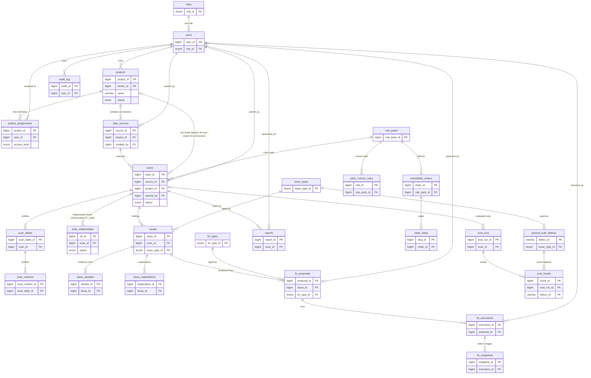

# V9 schema audit and final logical ER (project management layer)

Migration: `backend/src/main/resources/db/migration/V9__project_management_and_architecture.sql`
Status: written, reviewed and tested on a throwaway MySQL 8.0 in a sandbox. **Not applied to your database.** Waiting for your approval. A mirror copy is in `database/migrations/` (byte-identical).

Basis of this audit: the migrations V1 to V8 as written in this project (the copies in `database/migrations/`). I could not read your JPA entities, repositories, `application.yml` or git state, and the "second, detailed ER diagram" was not attached, so the target is taken from the entity and relationship list in the task brief.

---

## 1. Target architecture vs V1 to V8

| Target entity | Existing table(s) | Verdict | Name and column differences |
| --- | --- | --- | --- |
| ROLE | `roles` | Reused, unchanged | none |
| USER | `users` | Reused, unchanged | none |
| PROJECT | none | **New table `projects`** | n/a |
| (project membership) | none | **New table `project_assignments`** | n/a |
| DB_CONNECTION | `data_sources` | Reused, **extended** with `project_id` | `source_id` = connection_id |
| SCAN | `scans` | Reused, **extended** with `project_id` | `source_id` = connection_id, `started_by` = initiated_by, `status` = scan_status, `finished_at` = completed_at |
| SCAN_RESULT | `scans` + `scan_tables` | Reused; exposed through new view `v_scan_result` | `tables_scanned` = count of `scan_tables` rows, `records_checked` = sum of `scan_tables.row_count` (cast to BIGINT), `issues_found` = `scans.issues_found`, `generated_at` = `scans.finished_at` |
| ISSUE | `issues` | Reused, unchanged | none |
| TRACEABILITY_LINK | `scan_relationships` (scan-specific links) | Reused, unchanged | `from_table/from_column` = source, `to_table/to_column` = target, `status` = relationship_status |
| REPORT | `reports` | Reused, unchanged | project derived through `scans.project_id` |
| PROPOSED_FIX | `fix_proposals` | Reused, unchanged | none |
| ISSUE_EVIDENCE | `issue_samples` + `issue_explanations` | Reused, unchanged | samples are the row evidence, explanations are the AI text |

## 2. Tables

**Created (2):** `projects`, `project_assignments`

**Altered (2):** `data_sources` (adds `project_id` and two keys), `scans` (adds `project_id` and a composite foreign key)

**New view (1):** `v_scan_result`

**Reused unchanged (22 tables):** `roles`, `users`, `rule_packs`, `traceability_chains`, `chain_steps`, `pack_column_rules`, `scan_tables`, `scan_columns`, `scan_relationships`, `issue_types`, `issues`, `issue_samples`, `issue_explanations`, `fix_types`, `fix_proposals`, `fix_executions`, `fix_snapshots`, `audit_log`, `reports`, `ground_truth_defects`, `eval_runs`, `eval_results` (22 unchanged plus the 2 altered tables account for the 24 original tables). After V9 there are **26 tables and 4 views**.

## 3. Decisions

**SCAN_RESULT needs no new table.** All four of its fields already exist or can be computed from `scans` and `scan_tables`. A separate table would store the same numbers twice and could drift. The view `v_scan_result` gives the backend one place to read the SCAN_RESULT shape. It can be dropped without losing data.

**TRACEABILITY_LINK needs no new table.** Three different concepts are involved, and they stay separate:
- *Configured rules*: `traceability_chains`, `chain_steps`, `pack_column_rules` (what should be true).
- *Relationships found in one scan*: `scan_relationships` (what the scan discovered, with origin, confidence and review status). This is the TRACEABILITY_LINK entity.
- *Scan-specific chain findings* (rows reaching each step): the planned `scan_chain_results` table, not part of V9.

**ISSUE_EVIDENCE needs no new table.** `issue_samples` holds the sample rows, `issue_explanations` holds the grounded explanation, and the measured counts are on `issues` itself.

**`scans.project_id` is added, with a composite foreign key.** Two options were considered:
1. *Derive the project through `data_sources`.* No redundancy, but a past scan's project would change if its connection were later moved to another project, and scans of an unassigned connection would belong to no project.
2. *Store `project_id` on the scan and enforce consistency in the database.* **Chosen.** It records the project the scan ran under, as a historical fact, consistent with how `issues` stores snapshot values.

Option 2 is a deliberate, small redundancy (`scan_id -> source_id -> project_id`), made safe by the composite foreign key `(source_id, project_id) -> data_sources(source_id, project_id)`. MySQL does not check a foreign key when one of its columns is NULL, so legacy scans (NULL project) stay valid, while a new scan can only name the project its connection belongs to.

**Multiple connections per project.** `data_sources.project_id` is a many-to-one link: any number of connections can point to one project. Each scan then names one connection and its project.

**Project name uniqueness.** `UNIQUE (owner_id, name)`: names are not global, but one owner cannot have two projects with the same name.

**Reports.** `reports` stays as is. Its project is derived from its scan. Project-level reports that span several scans are not supported (see open issues).

## 4. New foreign keys

| Constraint | Meaning | Delete / update rule |
| --- | --- | --- |
| `fk_project_owner`: `projects.owner_id` -> `users.user_id` | every project has an owner | RESTRICT / RESTRICT (users are disabled, never deleted) |
| `fk_pa_project`: `project_assignments.project_id` -> `projects.project_id` | membership belongs to a project | CASCADE on delete (membership is not history), RESTRICT on update |
| `fk_pa_user`: `project_assignments.user_id` -> `users.user_id` | member is a real user | RESTRICT / RESTRICT |
| `fk_ds_project`: `data_sources.project_id` -> `projects.project_id` | connection belongs to a project (optional) | RESTRICT / RESTRICT: a project with connections cannot be deleted |
| `fk_scan_source_project`: `scans(source_id, project_id)` -> `data_sources(source_id, project_id)` | scan's project must match its connection's project | RESTRICT / RESTRICT: a connection cannot be moved to another project while scans recorded the old one |

The existing `fk_scan_source` (`scans.source_id` -> `data_sources.source_id`) is kept. The database now has 33 foreign keys (28 from V1 to V8, 5 new).

## 5. Indexes and uniqueness

| Index | Purpose |
| --- | --- |
| `projects`: `UNIQUE (owner_id, name)` | per-owner unique names; also serves lookups of an owner's projects and the owner foreign key |
| `project_assignments`: primary key `(project_id, user_id)` | prevents duplicate assignment; serves "users of a project" |
| `project_assignments`: `idx_pa_user (user_id, project_id)` | "projects of a user"; serves the user foreign key |
| `data_sources`: `idx_ds_project (project_id)` | serves the project foreign key and "connections of a project" |
| `data_sources`: `UNIQUE uq_ds_source_project (source_id, project_id)` | makes the pair referenceable by the composite foreign key on `scans` (always unique, since `source_id` is the primary key) |
| `scans`: `idx_scans_project (project_id, started_at)` | "scans of a project, newest first" |
| `scans`: `idx_scans_source_project (source_id, project_id)` | serves the composite foreign key |

## 6. Existing data and backfill

Nothing is backfilled. After V9, every existing `data_sources` row and every existing `scans` row has `project_id = NULL`, and all other columns are unchanged. Existing connections and scans remain fully valid.

Backfill that may be wanted later, **only after you approve it** and after each connection has been assigned to a project by a person:

```sql
-- Not part of V9. Run only after review.
UPDATE scans s
JOIN data_sources d ON d.source_id = s.source_id
SET s.project_id = d.project_id
WHERE s.project_id IS NULL AND d.project_id IS NOT NULL;
```

## 7. Final logical ER diagram (Mermaid)

Keys and the main attributes only; every column is in the migrations. Entities added or changed by V9 are `projects`, `project_assignments`, `data_sources`, `scans`.



## 8. Target elements represented by existing tables

- SCAN_RESULT: `scans` and `scan_tables`, read through the view `v_scan_result`.
- TRACEABILITY_LINK: `scan_relationships` (scan-specific links) plus the rule tables (configuration).
- ISSUE_EVIDENCE: `issue_samples` and `issue_explanations`.
- DB_CONNECTION: `data_sources`. PROPOSED_FIX: `fix_proposals`. ROLE and USER: `roles` and `users`.

## 9. Open issues and decisions for you

1. **Migration numbering (resolved in the documentation).** The roadmap reserved V9 for `scan_chain_results`, V10 for the fix-workflow columns and V11 for the evaluation method enum. With V9 now used by this migration, those become V10, V11 and V12. `docs/normalization.md` (Part E) and `docs/er_traceguard_app.png` are updated (26 tables, 33 foreign keys), and `docs/roadmap_migration_renumbering.md` lists the roadmap passages that still use the old numbers.
2. **Global connection names.** `data_sources.name` is still globally UNIQUE (from V1). Two projects therefore cannot each have a connection called "production". Changing that means dropping a V1 constraint, which this task forbids. It could be a later migration (`UNIQUE (project_id, name)`).
3. **New scans need a project.** The database allows `scans.project_id = NULL` so that legacy scans stay valid. Requiring a project for new scans has to be done in the backend until legacy rows are backfilled (then it could become NOT NULL).
4. **Project owner and assignments.** The owner is not required to have a `project_assignments` row; owner access is implied by `projects.owner_id`. The brief did not say otherwise. Also, "an AUDITOR must be READ_ONLY" cannot be enforced across `users.role` and `project_assignments.access_level` by a plain constraint, so it stays in backend logic as specified.
5. **Moving a connection.** Once a scan has recorded a project, its connection cannot be moved to another project (the update is refused). This protects history, but a move would need a new connection record.
6. **Project-level reports.** `reports.scan_id` is NOT NULL, so every report belongs to a scan. If a project-wide report spanning several scans is wanted, that needs `scan_id` made nullable plus a `project_id`. I did not add it because the brief says not to add redundant columns without justification.
7. **Versions.** The brief says Spring Boot 3.5.16; earlier messages said 4.1.1. The SQL does not depend on it, but the pinned library versions in the roadmap (Step 2A.1) do.

---

## 10. Final review (Nov 16, 2026)

All database checks below were run on a **fresh scratch MySQL 8.0.46 in a sandbox**: V1 to V8 from `database/migrations/`, then V9. Your MySQL 9.7.1 was not available, and your own database was not touched.

| Check | Result |
| --- | --- |
| V9 applies on top of V1 to V8 in Flyway order | passes; 26 tables (all InnoDB), 4 views |
| Foreign-key column types, charset and collation, all 34 FK columns | 0 mismatches |
| Nullability of the new columns | as designed: `data_sources.project_id` and `scans.project_id` NULL; all other new columns NOT NULL except `projects.description` |
| Referenced key of the composite FK | `uq_ds_source_project` is a UNIQUE index (MySQL 8.4 and later refuse foreign keys to non-unique keys by default, so this is required) |
| Legacy scan with NULL `project_id` (inserted the V8 way) | accepted, unchanged |
| New scan, project matches its connection | accepted |
| New scan, project differs from its connection, or project set on a connection with none, or unknown project | rejected (error 1452) |
| Setting a legacy scan to a mismatching project | rejected |
| Moving a connection to another project after scans recorded its project | rejected (error 1451) |
| Audit query for inconsistent scans after all tests | 0 rows |
| Backfill statement (section 6), after a connection is assigned to a project | updates the scans of that connection that have no project; scans of connections without a project are untouched |
| `v_scan_result`, completed scan | 2 tables, 930 records, 3 issues, `generated_at` = `finished_at` |
| `v_scan_result`, RUNNING scan | tables profiled so far, records so far, `issues_found` 0, `generated_at` NULL |
| `v_scan_result`, QUEUED scan | 0, 0, 0, NULL |
| `v_scan_result`, FAILED scan | 0 tables unless some were profiled; `generated_at` = `finished_at` if the backend set it |
| `v_scan_result` vs direct computation, 8 test scans | identical; one row per scan |
| Row counts above the INT range (3,000,000,005) | correct, because `records_checked` is BIGINT |

**Defect found and fixed during this review.** `records_checked` was `DECIMAL(41,0)`, because MySQL's SUM over a BIGINT returns a decimal. An entity mapping it as `Long` would fail Hibernate's schema validation. V9 now casts it to BIGINT, and the column is verified as `bigint`. V9 was never applied, so editing it is safe.

**Related note on V7 (not changed, V1 to V8 are frozen).** `v_scan_summary.rows_affected` is also `DECIMAL(41,0)`. Map it as `BigDecimal`, or cast it in the query that reads it.

### Compatibility of the existing backend (reasoned, not inspected)

I could not read your entities or repositories, so this is what follows from the schema alone. Please confirm it against your code:

- Hibernate `ddl-auto: validate` checks that every *mapped* column exists; it ignores extra columns and tables. Existing `DataSource` and `Scan` entities therefore keep validating after V9 with no change.
- Existing inserts that do not mention `project_id` still work (NULL is allowed).
- The new tables have no entities yet. When they are added: `Project` (map `updated_at` as not insertable and not updatable; `status` as `EnumType.STRING`) and `ProjectAssignment` (an embedded key of `project_id` and `user_id`; `access_level` as `EnumType.STRING`).
- When `project` is added to the `Scan` entity, a mismatch between the scan's project and its connection's project comes back from MySQL as a foreign-key violation (error 1452). Check it in the service first and return a clear error.
- Role names (ADMIN, DEVELOPER, AUDITOR) and the existing enums are unchanged.
